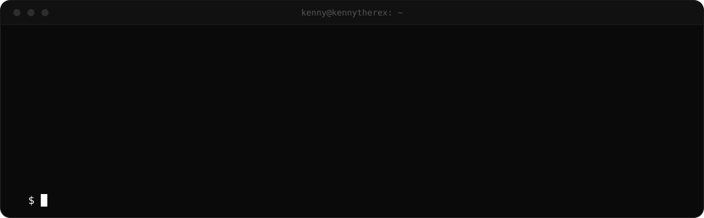

  

  
  
  
  

  

  <b>Cybersec guy with a programming kink.</b> 
  I break things, build things, and write about it on my <a href="https://kennytherex.dev"><b>blog</b></a>.

  
  
  
  
  
  
  
  

  
  

<code>just hack, code, and documentation.</code>

